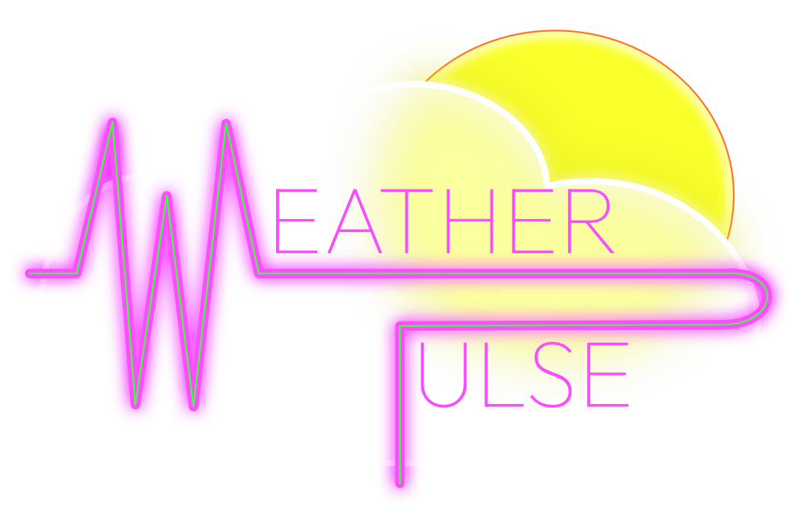

<div align="center">
  

  # WeatherPulse Mobile

  **Real-time weather forecast & air quality tracking, on your phone**

  
  
  
  
  
  
</div>

---

## Table of Contents

- [About the Project](#about-the-project)
- [Getting Started](#getting-started)
- [Running the Tests](#running-the-tests)
- [Troubleshooting](#troubleshooting)
- [Tech Stack](#tech-stack)
- [Key Features](#key-features)
- [Project Structure](#project-structure)
- [Technical Highlights](#technical-highlights)
- [From Web to Mobile](#from-web-to-mobile)
- [Future Improvements](#future-improvements)
- [License](#license)

---

## About the Project

WeatherPulse Mobile is the iOS and Android version of [WeatherPulse](https://github.com/julienjave/weatherpulse), a weather app I first built for the web with React and Vite as an assignment for my Software Development Bootcamp. This version is built with **Expo** and **React Native** and keeps the same features and look.

You can look up any city in the world by name, by coordinates or from your phone's location. The app then shows:

- the **current conditions** (temperature, "feels like", description, local date & time)
- a **24-hour temperature trend** chart
- a **4-day forecast**
- **humidity, wind speed and air quality** (converted to the US EPA AQI scale)

The whole UI changes its look to match the weather. Each condition (clear day, clear night, rain, snow, thunderstorm, etc.) has its own gradient and icon set. You can also save up to three cities as favorites so they're one tap away next time.

All weather data comes from the [OpenWeatherMap API](https://openweathermap.org/api).

---

## Getting Started

### Prerequisites

- [Node.js](https://nodejs.org/) **22.13+** or **24.3+** (required by Expo SDK 58), with npm
- A phone with the **Expo Go** app ([iOS](https://apps.apple.com/app/expo-go/id982107779) / [Android](https://play.google.com/store/apps/details?id=host.exp.exponent)). Make sure it's up to date: it must support **Expo SDK 58**.
  - Alternatively, an [Android emulator](https://docs.expo.dev/workflow/android-studio-emulator/) or, on a Mac, an [iOS simulator](https://docs.expo.dev/workflow/ios-simulator/).
- A free **OpenWeatherMap API key**. You need your own: the repository doesn't include one.
  1. Sign up at [openweathermap.org](https://home.openweathermap.org/users/sign_up).
  2. Copy your key from the [*API keys*](https://home.openweathermap.org/api_keys) tab.

  > ⚠️ New keys can take up to ~2 hours to activate. Until then, the app shows an "Invalid API key" error.

### Installation

1. **Clone the repository**

   ```bash
   git clone https://github.com/julienjave/weatherpulse-mobile-expo.git
   cd weatherpulse-mobile-expo
   ```

2. **Install the dependencies**

   ```bash
   npm install
   ```

3. **Add your API key**

   Copy the example environment file:

   ```bash
   cp .env.example .env
   ```

   On Windows (Command Prompt), use `copy .env.example .env` instead.

   Then open `.env` and replace `your_api_key_here` with your key:

   ```env
   EXPO_PUBLIC_OPENWEATHER_API_KEY=your_api_key_here
   ```

   > `.env` is in `.gitignore`, so your key won't be committed.

4. **Start the app**

   ```bash
   npx expo start
   ```

   A QR code appears in the terminal:

   - **On a phone:** connect it to the same Wi-Fi network as your computer, then scan the QR code. On Android, scan it from the Expo Go app; on iOS, use the Camera app.
   - **On an emulator or simulator:** press `a` (Android) or `i` (iOS, Mac only) in the terminal.

### Available Scripts

| Command | Description |
| --- | --- |
| `npm start` | Start the Expo dev server (same as `npx expo start`) |
| `npm run android` | Start the dev server and open the app on an Android emulator or connected device |
| `npm run ios` | Start the dev server and open the app on the iOS simulator (Mac only) |
| `npm test` | Run the test suite once |
| `npm run test:watch` | Run the tests in watch mode |
| `npm run typecheck` | Type-check the project with TypeScript |
| `npm run lint` | Run ESLint |

---

## Running the Tests

```bash
npm test
```

The suite has **358 tests in 29 files**: every hook and component, the API service, all the logic utils, the home screen, and an integration test for the search bar. Network calls, device location and storage are mocked, so the tests run fast and offline, and you don't need an API key to run them.

---

## Troubleshooting

| Problem | Solution |
| --- | --- |
| "Invalid API key" toast | Check the key in `.env`. A brand-new key can take up to ~2 hours to activate. |
| You changed `.env` but the app still uses the old key | Stop the dev server and restart it with `npx expo start --clear`. The key is built into the app when it's bundled. |
| The phone can't connect to the dev server | Check that the phone and computer are on the same Wi-Fi network. On restricted networks (school, office), run `npx expo start --tunnel`. |
| Expo Go says the project is incompatible | Update Expo Go from the app store: it must support Expo SDK 58. |
| "Use my location" shows a warning | Allow location access for Expo Go in the phone's settings, and make sure location services are turned on. |

---

## Tech Stack

### Core

| Technology | Purpose |
| --- | --- |
| [Expo SDK 58](https://docs.expo.dev/) | Tooling, dev server, and native modules (location, fonts, splash screen…) |
| [React Native 0.88](https://reactnative.dev/) + [React 19](https://react.dev/) | Native UI with function components and custom hooks |
| [TypeScript](https://www.typescriptlang.org/) | Static typing across components, hooks, API responses and utils |
| [Expo Router](https://docs.expo.dev/router/introduction/) | File-based navigation (`app/` folder) |

### External Libraries

| Library | Purpose |
| --- | --- |
| [React Native Paper](https://callstack.github.io/react-native-paper/) | Material Design components (text inputs, buttons, chips, switch, snackbar, tooltips…) |
| [@expo/vector-icons](https://docs.expo.dev/guides/icons/) | UI icons (search, location, favorites star, humidity, wind…) |
| [react-native-gifted-charts](https://gifted-charts.netlify.app/) + [react-native-svg](https://github.com/software-mansion/react-native-svg) | 24-hour temperature trend area chart |
| [React Native Reanimated](https://docs.swmansion.com/react-native-reanimated/) | Entry/exit animations, animated unit changes |
| [expo-linear-gradient](https://docs.expo.dev/versions/latest/sdk/linear-gradient/) | Weather theme gradients |
| [expo-location](https://docs.expo.dev/versions/latest/sdk/location/) | "Use my location" (permission + position) |
| [AsyncStorage](https://react-native-async-storage.github.io/async-storage/) | Saving favorite cities on the device |
| [expo-font](https://docs.expo.dev/versions/latest/sdk/font/) + [Outfit](https://fonts.google.com/specimen/Outfit) | Custom font for the app title |

### APIs

| API | Used for |
| --- | --- |
| OpenWeatherMap **Current Weather** (`/data/2.5/weather`) | Current conditions |
| OpenWeatherMap **5 Day / 3 Hour Forecast** (`/data/2.5/forecast`) | Hourly trend + daily forecast |
| OpenWeatherMap **Air Pollution** (`/data/2.5/air_pollution`) | PM2.5 concentration → AQI |
| OpenWeatherMap **Geocoding** (`/geo/1.0/direct` & `/reverse`) | City search & coordinates → city name |
| Device location (via `expo-location`) | "Use my location" button |

### Testing & Tooling

| Tool | Purpose |
| --- | --- |
| [Jest](https://jestjs.io/) + [jest-expo](https://docs.expo.dev/develop/unit-testing/) | Test runner with React Native mocks |
| [React Native Testing Library](https://callstack.github.io/react-native-testing-library/) | Component, hook and integration tests |
| [ESLint](https://eslint.org/) (`eslint-config-expo`) | Linting |

---

## Key Features

- 🔍 **City search with autocomplete.** Results show up as you type. They're debounced, deduplicated, and show the state/region and country.
- 📍 **Search by coordinates.** Enter a latitude/longitude pair (validated against -90…90 / -180…180). The app reverse-geocodes it to a city name and falls back to a coordinate label if nothing is found.
- 🧭 **Use my location.** One tap asks for location permission and gets the weather where you are.
- 🌡️ **Current weather card.** Temperature, "feels like", description and the city's **local** date & time, adjusted for its time zone.
- 📈 **24-hour temperature trend.** Touch the chart to see the temperature, "feels like", chance of rain and conditions at each point.
- 📅 **4-day forecast.** Daily highs/lows built from the 3-hour forecast data.
- 💧 **Weather metrics.** Humidity, wind speed and an **air quality badge** (US EPA AQI, color-coded from *Good* to *Hazardous*).
- ⭐ **Favorites.** Save up to 3 cities. They're stored on the device and still there next time you open the app.
- 🔁 **°C / °F toggle.** Switch units at any time. The data is fetched again in the new unit and the values animate as they change.
- 🎨 **Dynamic weather themes.** Gradients and icons change with the condition and with day or night.
- ✨ **Animations.** Cards and favorite chips animate in and out. Animations turn off when the phone's "Reduce Motion" setting is on.
- ⏳ **Loading skeletons & error toasts.** A skeleton layout shows while data loads. Readable messages appear for API errors, rate limits, timeouts and denied location permission, colored by severity.
- ♿ **Accessibility.** Buttons, headings, alerts and loading states are labeled for screen readers (VoiceOver / TalkBack).

---

## Project Structure

```text
weatherpulse-mobile-expo/
├── app/                            # Expo Router screens (every file here is a route)
│   ├── _layout.tsx                 # Root layout: fonts, splash screen, theme, status bar
│   ├── index.tsx                   # Home screen: wires hooks to components
│   └── +not-found.tsx              # Fallback for unknown routes
│
├── assets/
│   ├── icons/                      # Weather condition icons (clear-day, rain, snow, tornado…)
│   ├── icon.png / adaptive-icon.png# App icons (iOS / Android)
│   ├── weather-pulse-bg.jpg        # App background image
│   └── weather-pulse-logo.png
│
├── components/                     # Presentational components
│   ├── SearchBar.tsx               # City autocomplete / coordinates form / "my location" button
│   ├── FavoritesBar.tsx            # Favorite city chips (animated add/remove)
│   ├── WeatherPanel.tsx            # Lays out all weather cards for the selected city
│   ├── WeatherPanelSkeleton.tsx    # Loading placeholder for the panel
│   ├── WeatherHeaderBar.tsx        # Favorite toggle + °C/°F switch
│   ├── CurrentWeatherCard.tsx      # Current temp, feels like, local date & time
│   ├── TemperatureTrendsCard.tsx   # 24h temperature chart
│   ├── ForecastCard.tsx            # 4-day forecast
│   ├── WeatherMetricsCard.tsx      # Humidity, wind, air quality badge
│   ├── NotificationToast.tsx       # Error / warning toasts
│   ├── AnimatedText.tsx            # Animated value changes (e.g. unit toggle)
│   └── __tests__/
│
├── hooks/                          # Custom hooks: all stateful logic lives here
│   ├── useWeather.ts               # Fetches current + forecast + AQI in parallel, unit toggle
│   ├── useCitySearch.ts            # Debounced, cancellable city search
│   ├── useGeolocation.ts           # Device location with permission handling and a timeout
│   ├── useFavorites.ts             # Favorite cities (max 3)
│   ├── useLocalStorage.ts          # useState persisted to AsyncStorage
│   ├── useNotification.ts          # Toast state
│   └── __tests__/
│
├── services/
│   ├── weatherApi.ts               # OpenWeatherMap client (timeouts, abort signals, error envelope)
│   └── __tests__/
│
├── types/
│   └── weather.ts                  # TypeScript types for API responses
│
├── utils/                          # Pure, framework-free helper functions
│   ├── aggregateForecast.ts        # 3-hour slots → daily highs/lows (city time zone aware)
│   ├── hourlyForecast.ts           # Data points for the 24h trend chart
│   ├── aqiConverter.ts             # PM2.5 → US EPA AQI (linear interpolation)
│   ├── weatherThemes.ts            # Condition code → gradient theme + icon
│   ├── weatherIcons.ts             # Icon file → bundled image
│   ├── formatLocalTime.ts          # City-local date/time formatting
│   ├── formatCountry.ts            # ISO country code → country name
│   ├── convertTemp.ts              # °C ↔ °F
│   ├── compareCities.ts            # Compare two locations by coordinates
│   ├── glassStyles.ts              # Shared card styles (white panels, "glass" cards)
│   ├── appColors.ts / appFonts.ts  # App-wide color and font names
│   └── __tests__/
│
├── __tests__/                      # Home screen tests (kept outside app/, which only holds routes)
├── test-utils/                     # Shared test helpers
├── app.json                        # Expo config: name, icons, splash screen, plugins
├── .env.example                    # Template for your .env file
├── jest.config.js / jest-setup.tsx # Test configuration and global mocks
└── package.json
```

**Architecture in short:** the home screen (`app/index.tsx`) brings everything together. The **hooks** hold the state and side effects. The **service** layer is the only place that talks to the network. **Utils** are pure functions, which makes them easy to unit test. **Components** mostly receive props and render.

---

## Technical Highlights

### ⏱️ Debounced & cancellable city search

Typing "London" letter by letter shouldn't fire 6 API calls. [`useCitySearch`](hooks/useCitySearch.ts) handles this in a few steps:

- A small hand-written `createDebounce()` utility waits **500 ms** after the last keystroke before calling the Geocoding API. It has a `.cancel()` method.
- Each request gets its own **`AbortController`**. If a new search starts before the previous one returns, the old one is aborted, so a slow, outdated response can't overwrite newer results.
- Queries shorter than 2 characters cancel the pending timer **and** the request in progress, then clear the dropdown.
- The dropdown says "Loading…" during the debounce delay, so "No cities found" doesn't flash before the search even starts.
- Results are **deduplicated**, because the Geocoding API often returns the same city twice (the city and its administrative area).

The same idea is used in [`weatherApi.ts`](services/weatherApi.ts). Every request merges a caller's abort signal with an 8-second **timeout** signal using `AbortSignal.any()`. Every response comes back as a `{ data, error }` envelope, so callers never need `try/catch` for HTTP errors.

### 📍 Device location

[`useGeolocation`](hooks/useGeolocation.ts) uses `expo-location` in three steps:

1. Ask for location permission (no prompt if it was already granted).
2. Check that the phone's location services are switched on.
3. Reuse a position up to 5 minutes old if the phone has one; otherwise request a fresh one. `expo-location` has no timeout option, so the request is raced against a 10-second timer.

Each failure (permission denied, services off, timeout) becomes a readable warning toast. `getLocation()` resolves with the coordinates, or with `null` on failure, so the caller can simply write:

```ts
const coords = await getLocation()
if (!coords) return
```

Once the coordinates are known, the app calls **reverse geocoding** to show a real city name. If that fails, it falls back to a `48.85°, 2.35°` label instead of showing an error.

### ⭐ Favorites & AsyncStorage

Favorites are built from two hooks:

- [`useLocalStorage<T>`](hooks/useLocalStorage.ts) is a `useState` that is saved to the device with AsyncStorage. It kept its web name, but unlike the browser's `localStorage`, AsyncStorage is **asynchronous**, so the saved value arrives just after the first render. Any change made before then is **queued and replayed** on top of the saved value, so a fast tap can't wipe the stored favorites. The hook also returns an `isHydrated` flag, so the favorites bar doesn't flash "No favorites yet" at launch.
- [`useFavorites`](hooks/useFavorites.ts) adds the business rules on top: max **3** favorites, add/remove toggle, and cities compared **by coordinates** instead of by name, since names can be ambiguous ("Paris, FR" vs "Paris, US").

### 📈 Charts & forecast data processing

OpenWeatherMap's free forecast endpoint returns data in **3-hour slots**, not daily summaries, so some processing was needed:

- [`aggregateForecast.ts`](utils/aggregateForecast.ts) groups the slots by day **in the city's local time zone**, not the phone's. It shifts each timestamp by the city's UTC offset, then reads it in UTC. From each group it extracts the daily min/max temperature and the main condition.
- [`hourlyForecast.ts`](utils/hourlyForecast.ts) builds the data points for the **24-hour trend** chart.
- [`TemperatureTrendsCard`](components/TemperatureTrendsCard.tsx) draws them with gifted-charts. The chart measures the space its card gives it, so it fits any screen width. Its Y axis is **zoomed onto the data** (2° above the highest and below the lowest temperature) rather than starting at 0, which would flatten a 15–20° day into a straight line and couldn't show temperatures below zero.

### 🌫️ Air quality (PM2.5 → US AQI)

OpenWeatherMap returns a 1–5 index, which is not very meaningful to most people. [`aqiConverter.ts`](utils/aqiConverter.ts) uses the raw **PM2.5** concentration instead. It converts it to the standard **US EPA AQI (0–500)** with the official breakpoints and linear interpolation formula, and returns the matching label and color.

### 🧪 Testing

Every hook, component and logic util, and the API service, has its own test file, plus tests for the home screen and an integration test for the search bar. The tests query the UI the way a screen reader sees it (by role and label), so they also check accessibility.

---

## From Web to Mobile

This app started as a port of the [web version](https://github.com/julienjave/weatherpulse). The hooks, services and utils were mostly reusable as-is; the UI layer had to be rewritten, because React Native has no DOM and no CSS.

| Web version | Mobile version |
| --- | --- |
| Vite | Expo CLI + Metro bundler |
| Material UI + Emotion (`sx` styles) | React Native Paper + `StyleSheet` |
| MUI Icons | `@expo/vector-icons` |
| Motion (Framer Motion) | React Native Reanimated |
| Recharts | react-native-gifted-charts |
| Browser Geolocation API | `expo-location` |
| `localStorage` | AsyncStorage |
| CSS gradients and `box-shadow` | `expo-linear-gradient` and React Native's `boxShadow` style |
| Vitest + React Testing Library | Jest + React Native Testing Library |

A few things worked differently than on the web:

- **Shadows.** React Native's older shadow props (`elevation` on Android, `shadow*` on iOS) also draw behind a view, which showed up as a gray box through the translucent cards. The newer `boxShadow` style works like CSS and only draws outside the view.
- **Dark mode.** React Native Paper follows the phone's dark-mode setting by default. Its dark theme made the text pale on the app's white cards, so the theme is fixed to light.
- **Text styles don't cascade.** On the web, a parent's font size and color apply to everything inside it. In React Native, a component has to receive its text style directly.
- **Tests are asynchronous.** In React Native Testing Library v14, `render`, `fireEvent` and `act` all return Promises and must be awaited.
- **Country names.** The web version shows "Paris, France". On the phone it shows "Paris, FR": the built-in `Intl.DisplayNames` lookup isn't available in React Native's JavaScript engine (Hermes), and the shorter code also suits a small screen.

---

## Future Improvements

- 📦 **App store release.** Build installable apps with [EAS Build](https://docs.expo.dev/build/introduction/). The OpenWeatherMap key would then need to move to a small server, because any `EXPO_PUBLIC_` variable is built into the app where anyone could extract it.
- 🗺️ **Interactive weather map.** Use [react-native-maps](https://docs.expo.dev/versions/latest/sdk/map-view/) with OpenWeatherMap's [weather map tile layers](https://openweathermap.org/api/weathermaps) (precipitation, clouds, temperature, wind). Tapping the map could also select a location.
- 📴 **Offline mode.** Cache the last viewed weather so the app shows something useful without a connection.

---

## License

This project is licensed under the **MIT License**. See the [LICENSE](LICENSE) file for details.

---

<div align="center">
  Built by <a href="https://github.com/julienjave">Julien Javelaud</a> · Weather data provided by <a href="https://openweathermap.org/">OpenWeatherMap</a>
</div>
